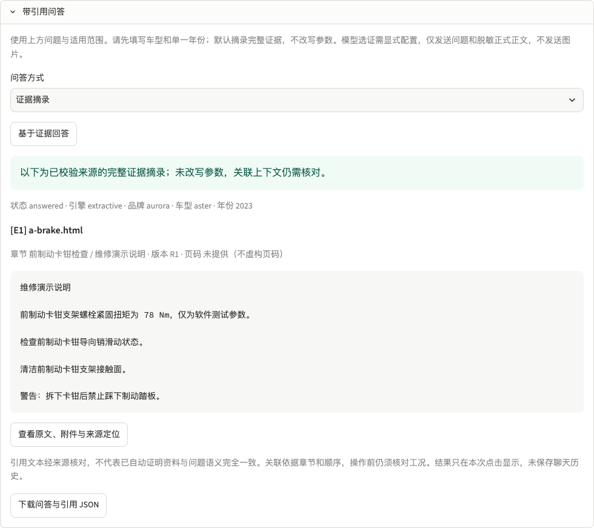

# AutoRepair Knowledge Pipeline

汽车维修知识加工与质量校验平台。将 HTML、JSON 内嵌 HTML、DOCX、PDF 加工成可追溯的 Markdown 和结构化语料，用品牌规则规范术语，并在入库前执行质量门禁。

这是面向知识加工岗位的本地作品项目。品牌、参数和样例文档均为自制演示数据。已对 3 份公开厂商维修通报抽样验证，仍不能据此指导实际维修。


当前版本 **0.11.0**。已有转换、规则加工、知识库、版本维护、三种检索及引用摘录问答；评估与作品演示工程已交付，外部人工盲测仍待完成。

- [作品说明与 5 分钟演示](docs/项目作品说明.md)
- [新冻结题集结果与失败案例](docs/冻结题集评估结果.md)
- [人工复核与数据集说明](benchmarks/repair-v1/README.md)

```bash
uv sync --frozen
.venv/bin/python scripts/demo_knowledge.py
.venv/bin/python -m streamlit run portfolio_app.py --server.address 127.0.0.1
```

演示使用隔离的 `work/portfolio-demo/`，非空目录不覆盖；不需要模型或密钥。Aurora 选 `aster / 2023`，Atlas 选 `ridge / 2021`。244 项软件测试通过。新题集并非全对：语义及混合前三正文召回 24/24，但可答题有标注依据作答 18/24，应拒答题拒答 19/20；标签尚未外部人工复核，不能据此宣称真实维修准确率。




## 已实现能力

- Docling 解析 DOCX、数字 PDF、扫描 PDF，保留标题级别、块、表格和来源位置；数字 PDF 可按矢量边框核对合并单元格。
- 静态 HTML DOM 提取，保留章节、嵌套列表、链接和图片替代文字；展开合并表格。JSON 字段名统一和内嵌 HTML 提取。
- 本地图像作为附件导出，DOCX 图片文字自动识别；图像与识别内容始终需要复核。
- 公共规则加独立品牌 YAML；明确覆盖关系、重复 ID、别名歧义及未知配置拒绝运行。
- 九阶段有序加工：结构、专名、引用、工具、部件、文风、长尾术语、联系信息脱敏、检索准备。
- 同一个 `BCM` 在 Aurora 下规范为“制动控制模块”，在 Atlas 下规范为“车身控制模块”。
- 每次修改带规则 ID、版本、块定位和脱敏后的前后内容；保护参数、单位、故障码、示例部件号及指定警告词。
- SQLite 保存运行历史、品牌术语表、文档引用和 `PN-...` 部件号的原文证据；车型与年份未知时保持未知。
- 通过、待复核、失败分别输出；仅通过项写入 `knowledge.jsonl`。PDF/DOCX 完整性需人工对照原文确认。
- 本地 Streamlit 工作台支持上传、规则差异、来源、问题列表、人工完整性复核、检索对照和 ZIP 下载。

## 快速开始

在项目根目录执行。使用 [uv](https://docs.astral.sh/uv/) 管理 Python 3.12 与锁定依赖。

```bash
uv sync --frozen
uv run streamlit run app.py --server.address 127.0.0.1 --browser.gatherUsageStats false
```

打开终端显示的本地地址，通常为 `http://127.0.0.1:8501`。选择品牌，点击“开始加工”，默认使用无需下载模型的 HTML 与 JSON 样例。

安装全部解析能力：

```bash
uv sync --frozen --extra docling
HF_HOME="$PWD/work/huggingface" uv run --extra docling streamlit run app.py --server.address 127.0.0.1 --browser.gatherUsageStats false
```

首次处理 PDF 会下载模型；首次验证在本机耗时约三分钟，之后复用缓存。初版验证环境依赖约 1.4 GB，Hub 模型缓存约 506 MB，完整 OCR 验证进程峰值 RSS 约 2097 MiB。这些是小样例实测，文件规模与机器不同会变化。扫描 PDF 必须勾选扫描识别。默认 CPU，不需要 LLM API Key。

macOS 可运行项目内 `启动工作台.command`，它会使用本地虚拟环境，不自动重新安装依赖。

## 命令行

```bash
# 单文件完整闭环，成功退出码为 0
uv run autorepair process examples/dev/aurora/01-manual.html --brand aurora

# 含待复核材料时退出码为 1；存在失败时为 2，结果仍保存
HF_HOME="$PWD/work/huggingface" uv run --extra docling autorepair process examples/dev/aurora --brand aurora

# 扫描样例
HF_HOME="$PWD/work/huggingface" uv run --extra docling autorepair process examples/holdout/aurora/06-service.pdf --brand aurora --ocr

# 查询跨批次累计的当前正式知识库
uv run autorepair search '氧传感器' --brand aurora
uv run autorepair catalog --brand aurora

# 显式查询历史批次；使用实际运行 ID
uv run autorepair search '氧传感器' --brand aurora --run RUN_ID
```

默认查询当前正式知识库并排除待复核文档。显式指定 `--run` 后可用 `--include-review` 做历史演示对照；历史结果不表示当前仍获准发布。加 `--original` 检索脱敏原文。分数为相关性排序，不是正确概率。

## 结果在哪里

每次运行写入独立 `artifacts/<run_id>/`，避免旧的通过产物混进新结果。

```text
artifacts/
  knowledge.sqlite             # 运行历史和映射库
  <run_id>/
    passed/                    # 已通过 Markdown 和规范 JSON
    review/                    # 待复核候选，图片资源在其 assets/ 内
    failed/                    # 失败诊断
    knowledge.jsonl            # 仅已通过文档
    knowledge-chunks.jsonl     # 本次通过资料的章节切块与关联
    results.json               # 含修改、问题与复核记录
    metadata-history.json      # 本次涉及文档的元数据修正记录
    quality-report.md
```

SQLite 的 `documents` 表仅保存当前通过项；`runs`、`parts`、`refs` 保留各次运行的证据记录。新运行若让同一品牌同一文档变为待复核或失败，会撤下旧的通过项。源文件只读；公开结果和前后视图执行范围明确的联系信息脱敏。

## 完整性复核

PDF/DOCX 解析成功后会保留 `parse.completeness` 待复核项。在界面选择该文档，自行对照原文件检查正文、表格和参数后，填写复核说明并确认。系统创建新运行记录；该操作只解除完整性待复核，其他警告和错误仍然阻止通过。

不能通过同一解析器输出的块数证明转换完整性。完整率必须用人工标注的原文块作分母，不能用字数比例代替。

## 配置与扩展

`configs/common.yaml` 存公共规则，`configs/brands/<brand>.yaml` 存品牌词表。新增品牌文件后，命令行可直接选择品牌；界面的品牌选项在 `app.py` 中维护。

```yaml
brand: example
terms:
  - canonical: 制动控制模块
    aliases: [BCM]
    kind: component
    entity_id: brake-control
rules:
  - id: structure
    action: structure
    overrides: true
```

`overrides: true` 必须对应已经存在的公共规则 ID。动作只允许注册的九个阶段，不执行 YAML 中的 Python。规则版本或词表改变会改变规则摘要。规范 JSON 可以作为再次加工的输入，用于验证幂等性。

核心模块：`html_parser.py` 处理 DOM，`formatting.py` 处理 Markdown 转义，`media.py` 处理图像，`pdf_tables.py` 核对矢量网格，`parsers.py` 接入，`config.py` 校验，`engine.py` 加工及门禁，`storage.py` 持久化，`pipeline.py` 编排输出，`search.py` 证据检索。

## 验证与已知限制

```bash
uv run pytest -q -m 'not docling'
uv run ruff check .
uv run ruff format --check .
uv run python scripts/evaluate.py

# 需要可用模型缓存；含英文扫描 OCR 和内存采样
HF_HOME="$PWD/work/huggingface" uv run --extra docling python scripts/validate_converters.py
uv run --extra docling pytest -q
```

第一版测试与界面验证已通过。固定题集为两个虚构品牌共 30 题，前五证据命中由加工前 20/30 变为加工后 30/30；候选检索包括待复核文档。8 份 DOCX/PDF 恢复了指定的 32 个文字锚点，数字 PDF 和 DOCX 保留了样例表格。详见 [实测报告](docs/第一版验证结果.md) 和 [解析原始结果](docs/converter-results.json)。

- 开发与验收样例共享生成结构，尚不构成独立真实业务评测。没有宣称已达到决策文档中的真实转换完整率或术语准确率目标。
- Word 支持 DOCX；旧版 DOC、动态网页、外部 CSS 计算尚不支持。复杂、无边框或扫描合并表格仍需真实材料验证。
- 图像保留不等于图像内容可靠或已脱敏；图片文字和原图均须复核，不会自动通过质量门禁。
- 静态 HTML 的 `aria-hidden` 按配置语义视为排除项，它不等同于浏览器视觉隐藏的完整判断。
- 未知术语检测只覆盖有限的全大写缩写；中文未知词和语义歧义需要人工术语表。
- 脱敏只覆盖有“电话／手机／phone／mobile”上下文的中国大陆手机号及有“车牌／plate”上下文的示例中国车牌，不能识别全部个人信息。
- 部件证据只提取 `PN-...` 示例编号；同段没有明确名称时不推断部件描述。还没有真实品牌的完整零件编码适配器。
- 参数保护是一组确定性检查，未覆盖全部自然语言含义；保留原文证据，人工确认优先。
- 本地单用户运行；没有身份认证、后台队列或云部署。问答采用来源摘录和可选模型选证。上传文件按本地可信使用场景设计。

## 开源来源与许可

[Docling](https://github.com/docling-project/docling) 提供文档解析。[Data-Juicer](https://github.com/datajuicer/data-juicer) 仅作配置化管道设计参考。品牌规则、领域映射、门禁与审阅流程为本项目新增代码。

业务代码与自制样例采用 [MIT](LICENSE)。第三方依赖与模型许可见 [上游说明](docs/THIRD_PARTY.md)，依赖精确版本见 `uv.lock`。仓库不包含厂商受限手册，不重新发布模型权重。

决策依据见 [开源选型与实施决策](docs/开源选型与实施决策.md)。

## 转 Markdown 保真专项测试

0.2.0 已修复 0.1.0 专项测试发现的章节扁平、HTML 表格错位、PDF 合并关系、图片遗漏、列表和链接问题。同一批 22 个样例复测：271/271 个内容检查点、21/21 个表格网格和 19/19 个多级章节通过。

修复前后证据分别保存在 `docs/fidelity/` 与 `docs/fidelity-fixed/`。详见 [修复验证报告](docs/Markdown保真修复验证.md)；历史问题报告仍保留。以上结果仅适用于本组自制样例，不代表真实手册无损转换。

```bash
FIDELITY_REQUIRE_PASS=1 FIDELITY_OUTPUT="$PWD/docs/fidelity-fixed" \
  HF_HOME="$PWD/work/huggingface" HF_HUB_OFFLINE=1 \
  uv run --extra docling python scripts/test_markdown_fidelity.py
```


### 真实维修资料验证（0.3.0）

使用 NHTSA 公开的 Toyota、Honda、Subaru 厂商维修通报共 16 页复测，修复稀疏边框表格退化、多层表头、未编号章节、跨页步骤编号和小型图标遗漏。固定抽查点复测：表格 8/8、章节 20/20、图片 16/16、步骤编号 5/5。真实资料仍需人工复核，原文及完整衍生产物不随仓库分发。

来源、修复前后证据和复现方法见 [真实汽车维修文档转换验证](docs/real-documents/README.md)。


## 知识库建设（0.4.0，第 1 项）

工作台侧边栏选择「知识库」，无需重新加工即可查看当前品牌文档目录并检索跨批次累计的通过资料。目录展示正式、待复核及失败状态；查询仅召回当前正式项，包含来源运行、规则摘要、章节路径、车型及年份。旧数据库自动补建目录。同品牌同文档 ID 更新为待复核或失败时，原通过内容立即退出正式查询；历史运行保留用于审计。

0.4.0 建立正式文档目录；0.5.0 已将正式查询接入持久化章节切块。BM25 查询时仍构建内存索引；元数据过滤、附件展示、版本管理及本地语义检索已完成至第 7 项；独立评估按 [知识库建设与实施计划](docs/知识库建设与实施计划.md) 继续推进。不同内容默认独立；0.8.0 可通过稳定逻辑身份或显式替换建立版本关系。


## 章节感知切块（0.5.0，第 2 项）

按章节与步骤组合短正文、分割长正文，表格、图片、图注和警告完整保留。每个切块带源块 ID、字符偏移、章节路径、页码、步骤关联及配置摘要；跨切块返回步骤、章节警告、相邻图表和明确文档内引用。超长表格等保留完整内容并显式标记，不静默截断。关联依据阅读顺序，需核对实际适用关系。

正式库自动补建旧文档切块，处理更新或撤下时同步维护；历史批次检索仍返回源块。工作台显示关联上下文，命令行 `autorepair chunks --brand aurora` 可查看完整切块，导出新增 `knowledge-chunks.jsonl`。

详见 [章节感知切块实现与验证](docs/章节感知切块验证.md)。87 项测试通过；切块审计覆盖 26 份输入的 437 个源块，规范化及原文字符按偏移还原均通过。以上只证明已转换内容的覆盖，不能替代原始文档完整性复核。


## 元数据录入与适用范围（0.6.0，第 3 项）

上传和 CLI 支持车型、年份、资料类型、资料版本及多车型配对范围；单文件清单可覆盖批次默认值。正式检索、目录及显式历史查询支持组合筛选，年份范围按区间相交匹配。指定条件时默认排除对应未知项，显式包含未知资料时显示适用性未确认提示，不把其他已知不适用资料混入结果。

知识库增加元数据修正表单、`metadata-correct` 与 `metadata-history` 命令；必须填写署名、原因和当前修订号，保存前后快照与来源运行。修正保持原审核状态，更新与索引在同一事务完成；旧库自动兼容。详见 [录入、过滤及修正验证](docs/元数据录入与过滤验证.md) 和 [演示清单](examples/metadata/demo-manifest.json)。119 项测试及原有格式、切块回归通过。


## 证据与附件展示（0.7.0，第 4 项）

知识库结果直接呈现表格与校验图片；点击「查看原文、附件与来源定位」可阅读脱敏解析原文和章节前后文，选择来源块及 PDF 物理页码，核对原页和定位框。加工审阅页也支持明确查看该次运行的候选证据。缺失或损坏附件、未保留原件及无法可靠标框的情况均明确显示，HTML／DOCX／JSON 不虚构页码。

本地输入原件按哈希独立保存在 SQLite，上传临时文件删除后仍可核对。**原件未脱敏，不包含在默认结果导出中；不要公开本地运行数据库。** 旧资料可用 `source-attach` 补挂哈希一致的原件，`evidence` 命令导出不含原件字节的证据包。PDF 预览需安装 `--extra docling`。

详见 [证据与附件展示验证](docs/证据与附件展示验证.md)。135 项测试通过；真实缓存资料的 16 页、18 个表格与 24 个不同附件通过展示验收，仍保持待复核。


## 文档与索引生命周期（0.8.0，第 5 项）

使用 `logical_id` 明确稳定资料身份，内容版本 ID 与来源哈希绑定。新版本通过后才替换活动版本；候选不挤掉已发布资料。支持 `versions`、`version-replace`、`withdraw`、`restore` 及 `lifecycle-history`，带修订号、署名、原因和事务审计。撤下后重新导入不会自动恢复；恢复只使用该版本最近保存的通过结果。

`index` 支持检查、增量修复及活动版本重建，使用内容指纹发现同数量损坏，并从已审核运行恢复缓存。默认不清理原件；`source-cleanup` 先预览，仅按令牌显式清理已撤下／替换版本的数据库原件副本，保护活动及暂存资料。清理后不会自动补回，需显式校验补挂；历史正文、图片、源文件和备份不在清理范围内。

正式 JSONL 仅导出当前活动且与本次运行一致的资料，新增 `publication.json`。详见 [生命周期实现与验证](docs/文档与索引生命周期验证.md)。156 项测试及 14 项隔离流程检查通过，转换、切块和证据展示回归通过。


## 本地语义与混合检索（0.9.0，第 6 项）

知识库支持 `--mode bm25|semantic|hybrid`，界面可切换；BM25 保持默认。本地中文模型 BGE-small-zh-v1.5 固定到提交修订，普通查询只加载本地缓存，首次下载需显式执行。语义窗口覆盖超长表格尾部，完整切块及关联证据仍保留。品牌、适用范围和发布状态先过滤，撤下或替换的旧版本不参与正式向量查询。

```bash
uv sync --extra docling --extra semantic
.venv/bin/autorepair semantic-model --download
.venv/bin/autorepair semantic-index --brand aurora --mode check
.venv/bin/autorepair search '刹车踩着发软' --brand aurora --mode semantic
.venv/bin/autorepair search 'P0300 检查项目' --brand aurora --mode hybrid
```

`semantic-index` 提供检查、增量及重建；正文向量按内容和模型配置缓存，可替换本地提供器。26 道不同自制题在两个品牌共评估 52 次，前三正文证据命中：BM25 42/52、语义 52/52、混合 46/52。混合并非总是更好；语义候选不能证明问题有答案，0.10.0 已提供证据摘录问答。0.9.0 的 178 项测试通过。模型准备、资源记录、逐题结果及限制见 [语义与混合检索验证](docs/语义与混合检索验证.md)。


## 带引用问答（0.10.0，第 7 项）

新增 `ask` 和工作台「带引用问答」。默认直接输出已核对来源的完整章节摘录、步骤、表格及警告，不需要大模型；可选显式配置的 Ollama 模型在合格证据中选证，输出不允许自由改写参数。要求明确车型和单一年份，证据不足、参数冲突、上下文超限或作答期间版本变化时停止作答。

```bash
.venv/bin/autorepair ask '火花塞安装扭矩是多少' --brand aurora --model sedan --year 2024
# 可选模型服务：配置只保存地址、模型和密钥环境变量名，不保存密钥
.venv/bin/autorepair ask 'P0300 的检查项目是什么' --brand aurora --model sedan --year 2024 \
  --engine ollama --qa-config configs/qa/ollama.example.yaml
```

引用含来源运行、块、章节、版本和实际页码；无页码不猜测。问答结果可下载 JSON，保留生成时快照。225 项测试和 18 项独立流程通过；Ollama 协议已测试，本机未执行真实 LLM 推理，不宣称生成或选证准确率。详见 [带引用问答验证](docs/带引用问答验证.md)。第 8 项评估和作品工程已交付，外部人工复核待完成。


## 评估与作品交付（0.11.0，第 8 项）

新增 20 份独立于原开发样例的自制资料、44 个场景（39 种不同问题文本），首次运行前冻结来源和预标注证据；生产检索与问答引擎保持 `381040c` 基线。新评分器区分正文召回、文件／锚点匹配、来源可追溯和拒答策略，不把机械引用匹配当作语义正确。

```bash
.venv/bin/python scripts/evaluate_benchmark.py --modes bm25 \
  --output work/benchmark.json --report work/benchmark.md
# 已准备本地 BGE 缓存时可选 --modes bm25 semantic hybrid
```

逐题失败公开保留：同义问题门禁仍保守，“气压”参数冲突策略存在未覆盖场景。244 项软件测试与 CI 的通过不等于所有问题回答正确。人工复核表保持待填写；支持导入真实署名记录并单列认可标签子集指标。见 [第 8 项工程交付及未测项](docs/第8项评估与作品交付.md)。
