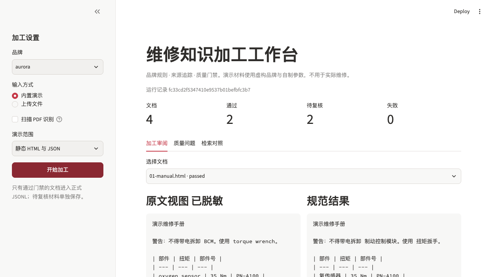

# AutoRepair Knowledge Pipeline

汽车维修知识加工与质量校验平台。将 HTML、JSON 内嵌 HTML、DOCX、PDF 加工成可追溯的 Markdown 和结构化语料，用品牌规则规范术语，并在入库前执行质量门禁。

这是面向知识加工岗位的本地作品项目。品牌、参数和样例文档均为自制演示数据。尚未在真实厂商维修手册上验证，不能据此指导实际维修。



## 已实现能力

- Docling 解析 DOCX、数字 PDF、扫描 PDF，保留标题级别、块、表格和来源位置；数字 PDF 可按矢量边框核对合并单元格。
- 静态 HTML DOM 提取，保留章节、嵌套列表、链接和图片替代文字；展开合并表格。JSON 字段名统一和内嵌 HTML 提取。
- 本地图像作为附件导出，DOCX 图片文字自动识别；图像与识别内容始终需要复核。
- 公共规则加独立品牌 YAML；明确覆盖关系、重复 ID、别名歧义及未知配置拒绝运行。
- 九阶段有序加工：结构、专名、引用、工具、部件、文风、长尾术语、联系信息脱敏、检索准备。
- 同一个 `BCM` 在 Aurora 下规范为“制动控制模块”，在 Atlas 下规范为“车身控制模块”。
- 每次修改带规则 ID、版本、块定位和脱敏后的前后内容；保护参数、单位、故障码、示例部件号及指定警告词。
- SQLite 保存运行历史、品牌术语表、文档引用和 `PN-...` 部件号的原文证据；车型与年份未知时保持未知。
- 通过、待复核、失败分别输出；仅通过项写入 `knowledge.jsonl`。PDF/DOCX 完整性需人工对照原文确认。
- 本地 Streamlit 工作台支持上传、规则差异、来源、问题列表、人工完整性复核、检索对照和 ZIP 下载。

## 快速开始

在项目根目录执行。使用 [uv](https://docs.astral.sh/uv/) 管理 Python 3.12 与锁定依赖。

```bash
uv sync --frozen
uv run streamlit run app.py --server.address 127.0.0.1 --browser.gatherUsageStats false
```

打开终端显示的本地地址，通常为 `http://127.0.0.1:8501`。选择品牌，点击“开始加工”，默认使用无需下载模型的 HTML 与 JSON 样例。

安装全部解析能力：

```bash
uv sync --frozen --extra docling
HF_HOME="$PWD/work/huggingface" uv run --extra docling streamlit run app.py --server.address 127.0.0.1 --browser.gatherUsageStats false
```

首次处理 PDF 会下载模型；首次验证在本机耗时约三分钟，之后复用缓存。初版验证环境依赖约 1.4 GB，Hub 模型缓存约 506 MB，完整 OCR 验证进程峰值 RSS 约 2097 MiB。这些是小样例实测，文件规模与机器不同会变化。扫描 PDF 必须勾选扫描识别。默认 CPU，不需要 LLM API Key。

macOS 可运行项目内 `启动工作台.command`，它会使用本地虚拟环境，不自动重新安装依赖。

## 命令行

```bash
# 单文件完整闭环，成功退出码为 0
uv run autorepair process examples/dev/aurora/01-manual.html --brand aurora

# 含待复核材料时退出码为 1；存在失败时为 2，结果仍保存
HF_HOME="$PWD/work/huggingface" uv run --extra docling autorepair process examples/dev/aurora --brand aurora

# 扫描样例
HF_HOME="$PWD/work/huggingface" uv run --extra docling autorepair process examples/holdout/aurora/06-service.pdf --brand aurora --ocr

# 将上一步输出的实际 run_id 填入，不要原样使用占位文本
uv run autorepair search '氧传感器' --brand aurora --run RUN_ID
```

检索默认排除待复核文档。加 `--include-review` 可做演示对照，加 `--original` 检索脱敏原文。分数为相关性排序，不是正确概率。

## 结果在哪里

每次运行写入独立 `artifacts/<run_id>/`，避免旧的通过产物混进新结果。

```text
artifacts/
  knowledge.sqlite             # 运行历史和映射库
  <run_id>/
    passed/                    # 已通过 Markdown 和规范 JSON
    review/                    # 待复核候选，图片资源在其 assets/ 内
    failed/                    # 失败诊断
    knowledge.jsonl            # 仅已通过文档
    results.json               # 含修改、问题与复核记录
    quality-report.md
```

SQLite 的 `documents` 表仅保存当前通过项；`runs`、`parts`、`refs` 保留各次运行的证据记录。新运行若让同一品牌同一文档变为待复核或失败，会撤下旧的通过项。源文件只读；公开结果和前后视图执行范围明确的联系信息脱敏。

## 完整性复核

PDF/DOCX 解析成功后会保留 `parse.completeness` 待复核项。在界面选择该文档，自行对照原文件检查正文、表格和参数后，填写复核说明并确认。系统创建新运行记录；该操作只解除完整性待复核，其他警告和错误仍然阻止通过。

不能通过同一解析器输出的块数证明转换完整性。完整率必须用人工标注的原文块作分母，不能用字数比例代替。

## 配置与扩展

`configs/common.yaml` 存公共规则，`configs/brands/<brand>.yaml` 存品牌词表。新增品牌文件后，命令行可直接选择品牌；界面的品牌选项在 `app.py` 中维护。

```yaml
brand: example
terms:
  - canonical: 制动控制模块
    aliases: [BCM]
    kind: component
    entity_id: brake-control
rules:
  - id: structure
    action: structure
    overrides: true
```

`overrides: true` 必须对应已经存在的公共规则 ID。动作只允许注册的九个阶段，不执行 YAML 中的 Python。规则版本或词表改变会改变规则摘要。规范 JSON 可以作为再次加工的输入，用于验证幂等性。

核心模块：`html_parser.py` 处理 DOM，`formatting.py` 处理 Markdown 转义，`media.py` 处理图像，`pdf_tables.py` 核对矢量网格，`parsers.py` 接入，`config.py` 校验，`engine.py` 加工及门禁，`storage.py` 持久化，`pipeline.py` 编排输出，`search.py` 证据检索。

## 验证与已知限制

```bash
uv run pytest -q -m 'not docling'
uv run ruff check .
uv run ruff format --check .
uv run python scripts/evaluate.py

# 需要可用模型缓存；含英文扫描 OCR 和内存采样
HF_HOME="$PWD/work/huggingface" uv run --extra docling python scripts/validate_converters.py
uv run --extra docling pytest -q
```

第一版测试与界面验证已通过。固定题集为两个虚构品牌共 30 题，前五证据命中由加工前 20/30 变为加工后 30/30；候选检索包括待复核文档。8 份 DOCX/PDF 恢复了指定的 32 个文字锚点，数字 PDF 和 DOCX 保留了样例表格。详见 [实测报告](docs/第一版验证结果.md) 和 [解析原始结果](docs/converter-results.json)。

- 开发与验收样例共享生成结构，尚不构成独立真实业务评测。没有宣称已达到决策文档中的真实转换完整率或术语准确率目标。
- Word 支持 DOCX；旧版 DOC、动态网页、外部 CSS 计算尚不支持。复杂、无边框或扫描合并表格仍需真实材料验证。
- 图像保留不等于图像内容可靠或已脱敏；图片文字和原图均须复核，不会自动通过质量门禁。
- 静态 HTML 的 `aria-hidden` 按配置语义视为排除项，它不等同于浏览器视觉隐藏的完整判断。
- 未知术语检测只覆盖有限的全大写缩写；中文未知词和语义歧义需要人工术语表。
- 脱敏只覆盖有“电话／手机／phone／mobile”上下文的中国大陆手机号及有“车牌／plate”上下文的示例中国车牌，不能识别全部个人信息。
- 部件证据只提取 `PN-...` 示例编号；同段没有明确名称时不推断部件描述。还没有真实品牌的完整零件编码适配器。
- 参数保护是一组确定性检查，未覆盖全部自然语言含义；保留原文证据，人工确认优先。
- 本地单用户运行；没有身份认证、后台队列、LLM 问答或云部署。上传文件按本地可信使用场景设计。

## 开源来源与许可

[Docling](https://github.com/docling-project/docling) 提供文档解析。[Data-Juicer](https://github.com/datajuicer/data-juicer) 仅作配置化管道设计参考。品牌规则、领域映射、门禁与审阅流程为本项目新增代码。

业务代码与自制样例采用 [MIT](LICENSE)。第三方依赖与模型许可见 [上游说明](docs/THIRD_PARTY.md)，依赖精确版本见 `uv.lock`。仓库不包含厂商受限手册，不重新发布模型权重。

决策依据见 [开源选型与实施决策](docs/开源选型与实施决策.md)。

## 转 Markdown 保真专项测试

0.2.0 已修复 0.1.0 专项测试发现的章节扁平、HTML 表格错位、PDF 合并关系、图片遗漏、列表和链接问题。同一批 22 个样例复测：271/271 个内容检查点、21/21 个表格网格和 19/19 个多级章节通过。

修复前后证据分别保存在 `docs/fidelity/` 与 `docs/fidelity-fixed/`。详见 [修复验证报告](docs/Markdown保真修复验证.md)；历史问题报告仍保留。以上结果仅适用于本组自制样例，不代表真实手册无损转换。

```bash
FIDELITY_REQUIRE_PASS=1 FIDELITY_OUTPUT="$PWD/docs/fidelity-fixed" \
  HF_HOME="$PWD/work/huggingface" HF_HUB_OFFLINE=1 \
  uv run --extra docling python scripts/test_markdown_fidelity.py
```
