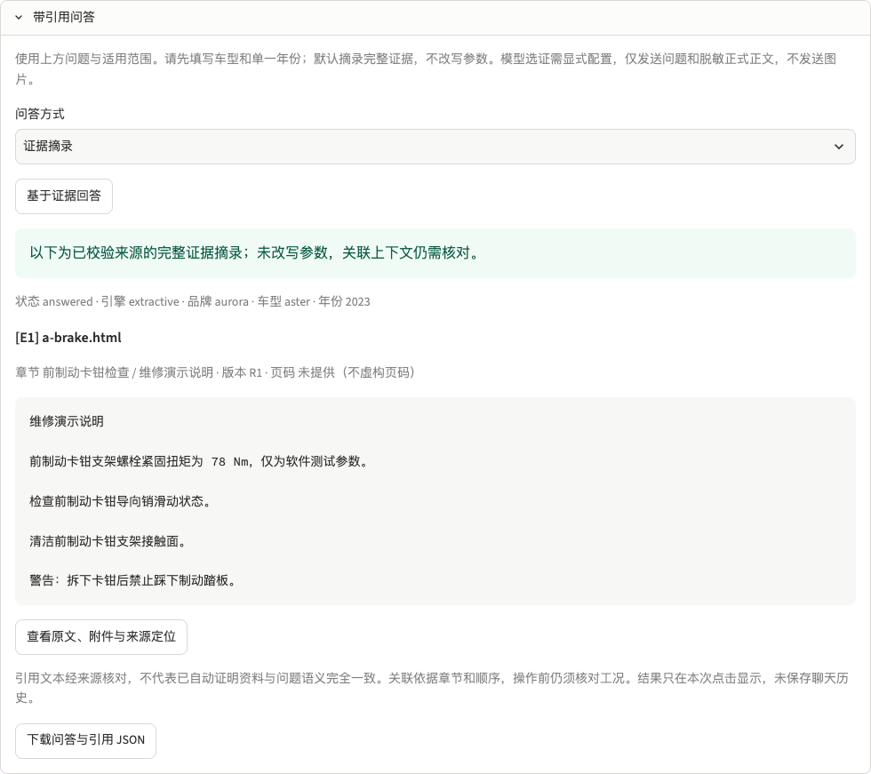
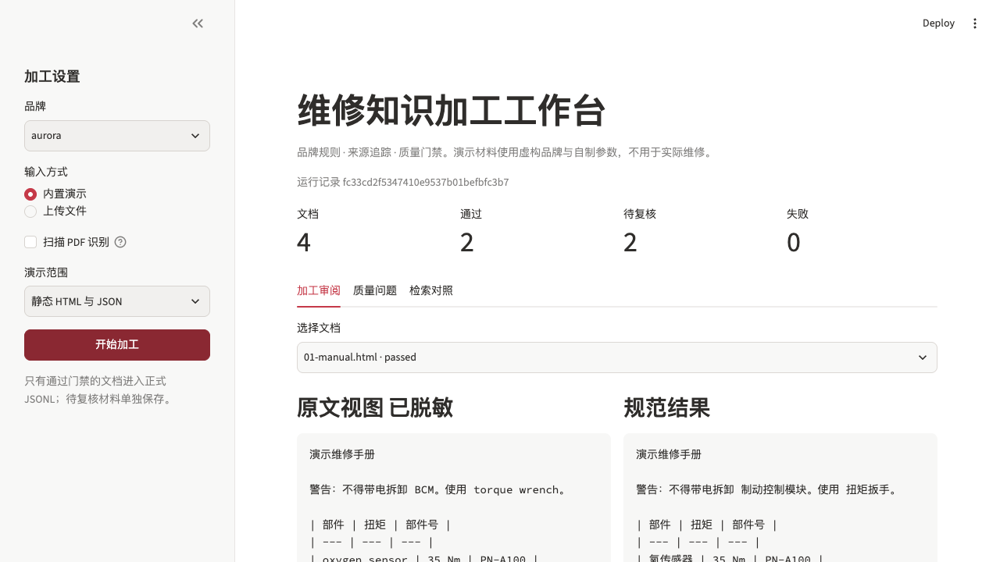

# 使用指南

本文从原 README 整理，保留输入格式、安装、命令行、输出目录、复核、配置和领域演示的详细说明。以下命令均在仓库根目录执行。

项目概览见 [首页](../README.md)，各阶段测试及版本演进见 [版本与验证记录](版本与验证记录.md)。现有 Python 模块与命令行入口仍为 `autorepair`；`--brand` 用于选择规则模板。

## 支持的输入

| 格式 | 解析与转换 |
| --- | --- |
| PDF | 数字 PDF；扫描 PDF 可启用 OCR；结构、表格及图片需要按结果复核 |
| DOCX | Word 文档的标题、段落、表格及图片 |
| HTML／HTM | 静态 DOM、章节、列表、表格、链接和本地图片 |
| JSON | 支持的记录字段、内嵌 HTML 及项目规范 JSON，不是任意 JSON 自动语义解析 |

Excel、PowerPoint、旧版 `.doc` 等格式目前没有专用转换入口。

## 已实现能力

- Docling 解析 DOCX、数字 PDF、扫描 PDF，保留标题级别、块、表格和来源位置；数字 PDF 可按矢量边框核对合并单元格。
- 静态 HTML DOM 提取，保留章节、嵌套列表、链接和图片替代文字；展开合并表格。JSON 字段名统一和内嵌 HTML 提取。
- 本地图像作为附件导出，DOCX 图片文字自动识别；图像与识别内容始终需要复核。
- 公共规则加独立品牌 YAML；明确覆盖关系、重复 ID、别名歧义及未知配置拒绝运行。
- 九阶段有序加工：结构、专名、引用、工具、部件、文风、长尾术语、联系信息脱敏、检索准备。
- 同一个 `BCM` 在 Aurora 下规范为“制动控制模块”，在 Atlas 下规范为“车身控制模块”。
- 每次修改带规则 ID、版本、块定位和脱敏后的前后内容；保护参数、单位、故障码、示例部件号及指定警告词。
- SQLite 保存运行历史、品牌术语表、文档引用和 `PN-...` 部件号的原文证据；车型与年份未知时保持未知。
- 通过、待复核、失败分别输出；仅通过项写入 `knowledge.jsonl`。PDF/DOCX 完整性需人工对照原文确认。
- 本地 Streamlit 工作台支持上传、规则差异、来源、问题列表、人工完整性复核、检索对照和 ZIP 下载。

## 快速开始

在项目根目录执行。使用 [uv](https://docs.astral.sh/uv/) 管理 Python 3.12 与锁定依赖。

```bash
uv sync --frozen
uv run streamlit run app.py --server.address 127.0.0.1 --browser.gatherUsageStats false
```

打开终端显示的本地地址，通常为 `http://127.0.0.1:8501`。选择品牌，点击“开始加工”，默认使用无需下载模型的 HTML 与 JSON 样例。

安装全部解析能力：

```bash
uv sync --frozen --extra docling
HF_HOME="$PWD/work/huggingface" uv run --extra docling streamlit run app.py --server.address 127.0.0.1 --browser.gatherUsageStats false
```

首次处理 PDF 会下载模型；首次验证在本机耗时约三分钟，之后复用缓存。初版验证环境依赖约 1.4 GB，Hub 模型缓存约 506 MB，完整 OCR 验证进程峰值 RSS 约 2097 MiB。这些是小样例实测，文件规模与机器不同会变化。扫描 PDF 必须勾选扫描识别。默认 CPU，不需要 LLM API Key。

macOS 可运行项目内 `启动工作台.command`，它会使用本地虚拟环境，不自动重新安装依赖。

## 命令行

```bash
# 单文件完整闭环，成功退出码为 0
uv run autorepair process examples/dev/aurora/01-manual.html --brand aurora

# 含待复核材料时退出码为 1；存在失败时为 2，结果仍保存
HF_HOME="$PWD/work/huggingface" uv run --extra docling autorepair process examples/dev/aurora --brand aurora

# 扫描样例
HF_HOME="$PWD/work/huggingface" uv run --extra docling autorepair process examples/holdout/aurora/06-service.pdf --brand aurora --ocr

# 查询跨批次累计的当前正式知识库
uv run autorepair search '氧传感器' --brand aurora
uv run autorepair catalog --brand aurora

# 显式查询历史批次；使用实际运行 ID
uv run autorepair search '氧传感器' --brand aurora --run RUN_ID
```

默认查询当前正式知识库并排除待复核文档。显式指定 `--run` 后可用 `--include-review` 做历史演示对照；历史结果不表示当前仍获准发布。加 `--original` 检索脱敏原文。分数为相关性排序，不是正确概率。

## 结果在哪里

每次运行写入独立 `artifacts/<run_id>/`，避免旧的通过产物混进新结果。

```text
artifacts/
  knowledge.sqlite             # 运行历史和映射库
  <run_id>/
    passed/                    # 已通过 Markdown 和规范 JSON
    review/                    # 待复核候选，图片资源在其 assets/ 内
    failed/                    # 失败诊断
    knowledge.jsonl            # 仅已通过文档
    knowledge-chunks.jsonl     # 本次通过资料的章节切块与关联
    results.json               # 含修改、问题与复核记录
    metadata-history.json      # 本次涉及文档的元数据修正记录
    quality-report.md
```

SQLite 的 `documents` 表仅保存当前通过项；`runs`、`parts`、`refs` 保留各次运行的证据记录。新运行若让同一品牌同一文档变为待复核或失败，会撤下旧的通过项。源文件只读；公开结果和前后视图执行范围明确的联系信息脱敏。

## 完整性复核

PDF/DOCX 解析成功后会保留 `parse.completeness` 待复核项。在界面选择该文档，自行对照原文件检查正文、表格和参数后，填写复核说明并确认。系统创建新运行记录；该操作只解除完整性待复核，其他警告和错误仍然阻止通过。

不能通过同一解析器输出的块数证明转换完整性。完整率必须用人工标注的原文块作分母，不能用字数比例代替。

## 配置与扩展

`configs/common.yaml` 存公共规则，`configs/brands/<brand>.yaml` 存品牌词表。新增品牌文件后，命令行可直接选择品牌；界面的品牌选项在 `app.py` 中维护。

```yaml
brand: example
terms:
  - canonical: 制动控制模块
    aliases: [BCM]
    kind: component
    entity_id: brake-control
rules:
  - id: structure
    action: structure
    overrides: true
```

`overrides: true` 必须对应已经存在的公共规则 ID。动作只允许注册的九个阶段，不执行 YAML 中的 Python。规则版本或词表改变会改变规则摘要。规范 JSON 可以作为再次加工的输入，用于验证幂等性。

核心模块：`html_parser.py` 处理 DOM，`formatting.py` 处理 Markdown 转义，`media.py` 处理图像，`pdf_tables.py` 核对矢量网格，`parsers.py` 接入，`config.py` 校验，`engine.py` 加工及门禁，`storage.py` 持久化，`pipeline.py` 编排输出，`search.py` 证据检索。

## 领域扩展示例与状态说明

当前版本 **0.12.0**。已有转换、规则加工、知识库、版本维护、三种检索及引用摘录问答；评估与作品演示工程已交付，外部人工盲测仍待完成。

- [汽车领域扩展示例与 5 分钟演示](项目作品说明.md)
- [新冻结题集结果与失败案例](冻结题集评估结果.md)
- [人工复核与数据集说明](../benchmarks/repair-v1/README.md)

```bash
uv sync --frozen
.venv/bin/python scripts/demo_knowledge.py
.venv/bin/python -m streamlit run portfolio_app.py --server.address 127.0.0.1
```

演示使用隔离的 `work/portfolio-demo/`，非空目录不覆盖；不需要模型或密钥。Aurora 选 `aster / 2023`，Atlas 选 `ridge / 2021`。285 项软件测试通过。0.12.0 已修复优先的气压冲突、表格工况绑定及同义问句门禁；原 0.11.0 失败基线仍保留。修复后已见题的可答覆盖 24/24、应拒答场景 20/20，新增 15 个开发场景在三模式共 45 次检查通过；这些不是人工盲测或真实维修准确率。详见 [参数绑定修复验证](问答参数绑定修复验证.md)。




