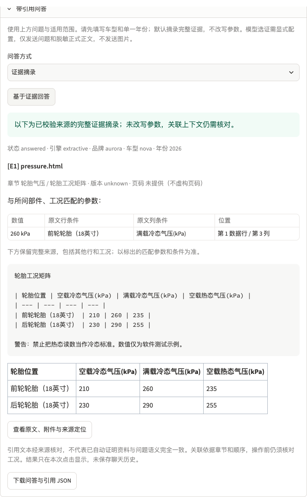

# 问答参数绑定与同义问句修复

版本：0.12.0；日期：2026-11-20。对应 v0.11.0 评估后优先改进的三项：气压冲突识别、表格条件与行列绑定、同义问句门禁。

## 修复结果

- 气压、胎压及轮胎气压纳入数值型问题。多个适用值不能任意挑选；缺少前后轮、载荷、温态等必要条件时，仍停止作答。
- 参数绑定到具体来源块、正文句子或表格数据行／列。单位可来自同一单元格或该列明确标注的唯一单位；其他行、其他数值列不能提供单位或工况。
- 对问句做有限的术语规范化和泛词清理，保留版本、配置摘要、替换记录及实际检索问句。来源正文、数值和引用文本不改写，不以语义相似度单独证明问题有答案。
- 工作台突出显示匹配数值、行条件、列条件与位置；下方继续保留完整表格、章节、步骤及警告。冲突状态只显示待核对候选，不能当作已确认答复。

## 表格与工况

支持明确标注的前／后轮、左／右侧、冷／热态、空／满／半载、怠速／高速条件。优先使用该数据行的文字标签和本列标题，必要时从明确的章节条件继承；行列与章节相互矛盾时拒绝绑定。条件未给出或表中没有说明，不能猜测。

新增演示矩阵：

| 位置 | 空载冷态气压(kPa) | 满载冷态气压(kPa) | 空载热态气压(kPa) |
| --- | --- | --- | --- |
| 前轮轮胎（18英寸） | 210 | 260 | 235 |
| 后轮轮胎（18英寸） | 230 | 290 | 255 |

以上仅为软件测试参数。

- 问“前轮轮胎满载冷态气压是多少”：只绑定数据行 1、列 3 的 `260 kPa`。
- 问“前轮轮胎冷态气压是多少”：空载和满载同时适用、数值不同，返回 `conflicting_evidence`。
- 问“左侧前轮轮胎空载冷态气压是多少”：资料没有左右侧信息，返回证据不足。
- 前后轮完整表格仍可核对。绑定数值明确指出哪个单元格对应问题，不从显示的其他行混取数值。

支持扭矩、电压、间隙、厚度／磨损极限、长度／直径／下降量、温度、气压／压力／油压、容量及周期。间隙和厚度虽然都可能使用 mm，也要检查对应列的参数名称，不能互换。

数字格式可归一化小数末尾零、`N·m/Nm`、明确范围分隔符和 Unicode 负号；不换算不同单位。表头与单元格单位矛盾、多个可能单位、缺少单位、比较值、公差、无法确定的多值单元格、千分位及异常列数均不猜测。复杂合并表头、跨行省略标签和自然语言隐含工况仍可能被保守拒答。

同一正文块中，无法分配给已识别工况／主题的另一个同单位数值不能悄悄覆盖已绑定事实；相关歧义会触发拒答。正文和工况语义分析仍是有边界的规则，不是通用自然语言理解。

## 同义问句与来源保护

规则在 [query-terms.yaml](../configs/qa/query-terms.yaml)，当前 `query-terms-v1`。例如刹车钳→制动卡钳、电瓶→蓄电池、防冻液→冷却液、胎压→轮胎气压，以及有限的口语表达。最长短语优先，单次替换，不递归；修改规则后重启应用生效。

问句和来源的主题比较可以在内存中使用规范术语，**发布引用始终是实际源文本**。故障码、部件号仍要求完整匹配；适用品牌、车型年份、审核状态和活动版本要求保持。默认问答的规范化查询与普通 `search` 的原始关键词查询分开，避免把别名收益误算为基础 BM25 排名算法提升。

模型仍只能选择合格证据 ID 或拒答，不能自行生成参数。传给可选选证模型的证据另带已绑定事实；最终文本、来源与参数由本地系统校验，生成前后继续复验文档版本和元数据。

## 可追溯输出

每条引用增加 `numeric_bindings`：

- 来源 `block_id`、正文片段或原表格单元格文字；
- 参数类别、原数值／单位及比较用规范值；
- 表格数据行号（从 1 开始，不计表头）、列号（从 1 开始）、原行标签和列标题；
- 单位来自单元格、列标题或正文的说明；
- 从明确来源文字解析的工况条件。

评分器另行核查这些源坐标、单元格文字、单位和数值，篡改数值、行列或工况标签会失败。该检查证明机械可追溯性，不代替人工语义审阅。



## 原基线与修复后回归

原始 [0.11.0 报告](冻结题集评估结果.md)、[JSON](benchmark-results.json) 和 `benchmarks/repair-v1` 的冻结资料／标签保持不变。新结果另存 [问答绑定回归结果](问答绑定回归结果.md) 和 [JSON](qa-binding-regression-results.json)。

| 指标（每个模式） | 0.11.0 基线 | 0.12.0 回归 |
| --- | --- | --- |
| 可答题有标注依据作答 | 18/24 | 24/24 |
| 应拒答／补范围场景停止作答 | 19/20 | 20/20 |
| 实际已答的来源可追溯 | 19/19 | 24/24 |
| 实际已答的预标注证据匹配 | 18/19 | 24/24 |

三个模式均达到上述问答结果。独立测量原始问句的前三正文召回仍是 BM25 21/24、语义和混合 24/24；问答阶段使用的规范化检索问句另行留痕。每个模式重复相同场景，不累计为新的独立样本。

这批问题已用于发现和修复，**新分数是回归指标，不是独立盲测、人工验证或真实维修准确率**。

## 新增开发验收及完整回归

[新增样例](../examples/qa-binding/manifest.json) 含 3 份自制 HTML、15 个开发验收场景。预期状态、数值及单元格坐标在首次执行前保存并校验摘要；它们由助手编写，仍不是外部独立人工评估。

真实本地 BGE 参与语义／混合召回，三个模式共执行 **45 次检查，全部通过**。逐项记录见 [新增绑定结果](qa-binding-results.json)。覆盖冷／热态、前／后轮、空／满载、单位继承、缺少条件、怠速／高速、同义表达与邻近故障码拒答。

完整套件 **285 项测试通过**，新增 41 项参数绑定验收。包括异常表格、单位与精度、不同部件、负号与范围、否定条件、完整警告保留、参数／行列篡改及界面显示。原有 18 项问答流程、14 项生命周期流程、26 份输入的章节切块覆盖，以及 3 份真实缓存资料的附件展示审计均通过。没有修改或清理实际原件库，也没有放行真实待复核资料。

浏览器在隔离自制库验证了口语问句的术语留痕、`260 kPa` 的具体行列、完整矩阵和警告；缺少载荷时停止作答。接口和真实 LLM 的验证边界仍沿用前版：本机未执行真实大语言模型选证质量评估。

复现：

```bash
HF_HOME="$PWD/work/huggingface" HF_HUB_OFFLINE=1 .venv/bin/pytest -q
HF_HOME="$PWD/work/huggingface" HF_HUB_OFFLINE=1 \
  .venv/bin/python scripts/evaluate_bindings.py --modes bm25 semantic hybrid
HF_HOME="$PWD/work/huggingface" HF_HUB_OFFLINE=1 \
  .venv/bin/python scripts/evaluate_benchmark.py --modes bm25 semantic hybrid \
  --output work/regression.json --report work/regression.md
```

CI 运行不下载模型的 BM25 参数绑定流程。外部人工盲测、真实 LLM 测评、更广泛的真实车型／资料验证仍未完成；有限别名和显式工况规则不能覆盖任意维修问句。
