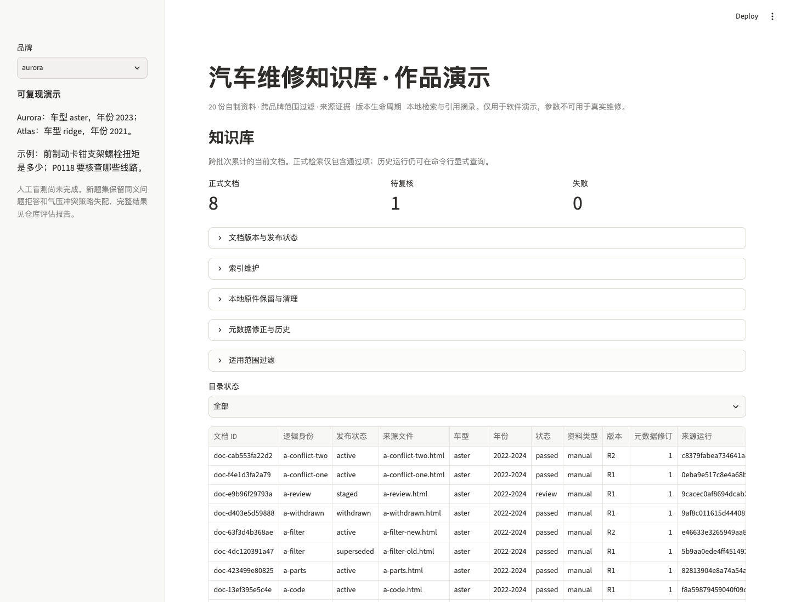
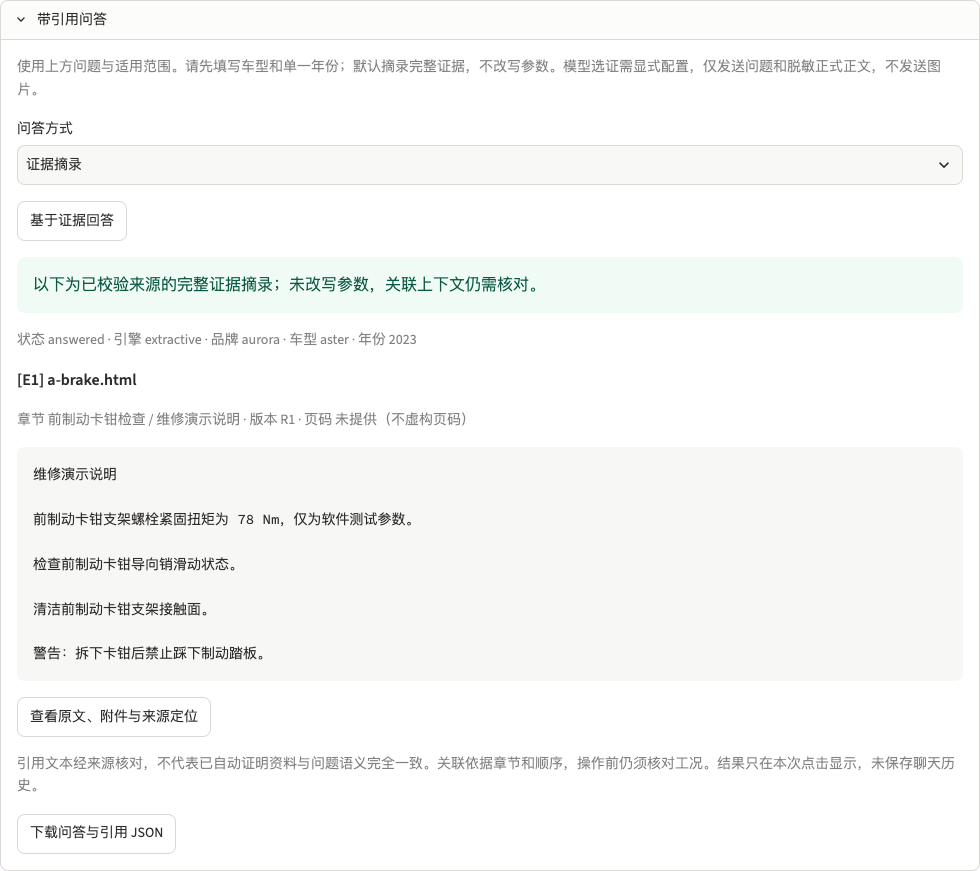

# 汽车维修知识加工与知识库：作品说明

版本：0.11.0；日期：2026-11-20。

本文件保留当时基线结果。当前 0.12.0 已完成气压冲突、表格工况绑定和有限同义问句修复，见 [修复验证](问答参数绑定修复验证.md)；不能将下方旧版缺口当作当前回归结果，也不能把新版回归称为盲测。

## 项目解决的问题

多品牌维修资料往往分散在 HTML、PDF、Word 和 JSON 中，存在结构不统一、缩写歧义、表格和图片容易遗漏、资料版本混用等问题。本项目把资料加工、审核、入库、检索和证据回查串成一个可在本机复现的工作流。

项目定位是个人工程作品。品牌及公开语料为自制示例；真实维修通报只在本地抽样验证，没有把它们作为已批准的维修知识公开。没有企业生产使用、用户规模或真实维修效果的主张。

## 对应岗位能力

| 岗位要求 | 本项目的实现 | 可检查的证据 |
| --- | --- | --- |
| 多源文档标准化 | HTML DOM、内嵌 HTML JSON、Docling PDF／DOCX；Markdown 与规范 JSON | 转换保真报告、格式样例、来源块及表格测试 |
| 知识规则引擎 | 结构、专名、引用、工具、部件、文风、长尾、联系信息脱敏、检索准备九阶段 | 品牌 YAML、规则版本与修改前后差异 |
| 多品牌配置隔离 | 公共规则与品牌覆盖；同缩写可映射到不同实体 | Aurora／Atlas 的 BCM 词表及隔离测试 |
| 结构化语料处理 | 字段规范、内嵌 HTML 提取、部件号与文档引用映射 | 规范模型、SQLite 映射表和审计运行 |
| 质量门禁 | passed／review／failed 分流；完整性复核及明确的图片待复核 | 不合格资料不进入正式查询和导出 |
| 知识库维护 | 稳定文档身份、版本替换／回退、撤下恢复、元数据修正、索引维护 | 生命周期审计、修订冲突和事务回滚测试 |
| 可追溯检索 | 章节／步骤切块，车型年份过滤，表格图片原文定位 | BM25、本地 BGE、RRF 与证据展示工作台 |
| 带引用问答与评估 | 完整来源摘录、可选 Ollama 选证、冻结题集与人工复核入口 | 问答报告、逐题结果、空白人工复核表 |

## 技术选择与自行实现范围

Python 3.12、SQLite、YAML、Streamlit 为主。Docling 负责 PDF／DOCX 文档解析；BeautifulSoup／lxml 处理静态 HTML；rank-bm25 提供关键词排序；本地 BGE 通过 Transformers／PyTorch 编码。

本项目自行实现品牌规则配置与验证、加工记录、参数保护、质量门禁、章节及步骤关系、适用范围与修正审计、文档版本发布、派生索引维护、证据引用展示、完整来源摘录及评估流程。它不是自行训练的 OCR、嵌入或大语言模型，也不是从零编写的文档解析器。

没有复制一个完整 RAG 平台再更换界面。已有开源组件承担底层解析和模型执行，领域规则、可追溯性与生命周期构成项目主体。仓库保留 MIT 许可证；依赖和模型分别遵循其原项目许可证。

## 最短演示路径

在仓库根目录执行，无需模型和 API Key：

```bash
uv sync --frozen
.venv/bin/python scripts/demo_knowledge.py
.venv/bin/python -m streamlit run portfolio_app.py --server.address 127.0.0.1
```

演示库只创建在 `work/portfolio-demo/`；目录非空时拒绝覆盖。原加工工作台仍用 `app.py`，两者数据库分开。重新演示可用 `--output work/另一个目录` 创建命令行样例库；`portfolio_app.py` 固定读取默认演示目录，不自动清理或切换用户库。

建议按下列步骤展示：

1. 选择 Aurora，筛选车型 `aster`、年份 `2023`。查询“前制动卡钳支架螺栓扭矩是多少”，点击「基于证据回答」，核对演示参数 `78 Nm`、步骤与禁止踩踏板的警告。
2. 查询“空气滤清器更换周期是多少”，核对活动版 `R2 / 12000 km`；旧版 `R1 / 9000 km` 留作历史，不能正式召回。
3. 选择 Atlas，改为车型 `ridge`、年份 `2021`，查询“前照灯近光基准下降量是多少”，核对当前 `40 mm`，旧版 `35 mm` 不参与正式答复。
4. 查看版本与发布状态、修正留痕、索引检查、原件清理预览。无需执行原件清理来完成作品演示。
5. 展示无答案、待复核和撤下场景，再打开冻结题集报告，说明成功与失败的分母。

界面实测截图，仅含公开自制资料：





命令行也可复现：

```bash
.venv/bin/autorepair ask '前制动卡钳支架螺栓扭矩是多少' --brand aurora \
  --model aster --year 2023 --database work/portfolio-demo/knowledge.sqlite
.venv/bin/python scripts/evaluate_benchmark.py --modes bm25 \
  --output work/reproduction.json --report work/reproduction.md
```

语义模式需要另行安装可选依赖和显式下载固定修订 BGE 模型；普通查询只用本地模型缓存。Ollama 选证需要显式服务配置，尚未在本机运行真实 LLM 质量测评。

## 当前结果怎么解释

完整测试 244 项通过，其中新增 19 项评估器验收。软件测试验证事务、来源、过滤、缓存和错误处理，不等于对任意维修问题的准确率。

新冻结题集为 20 份资料、44 个场景（39 种不同问题文本），可答 24、预期拒答或补范围 20。三个检索模式运行相同场景，不按 132 个独立样本宣传。

| 模式 | 前三正文召回 | 可答题有标注依据作答 | 应拒答场景停止作答 |
| --- | --- | --- | --- |
| BM25 | 21/24 | 18/24 | 19/20 |
| 本地语义 | 24/24 | 18/24 | 19/20 |
| RRF 混合 | 24/24 | 18/24 | 19/20 |

每个模式实际回答 19 题，来源可追溯 19/19，但匹配预标注支持证据为 18/19。**能逐字追溯不等于语义正确**。六个可答场景被保守拒答，包括若干口语同义问题和带额外泛词的故障码问题；`t14` 预期冲突拒答却返回前后轮完整气压表，暴露“气压”意图未被现有参数冲突规则覆盖。这里的负例作答不表示虚构了表格数值，但违反预设拒答策略。

完整失败列表、锚点及逐题引用见 [冻结题集评估结果](冻结题集评估结果.md) 和 [JSON](benchmark-results.json)。没有删除失败题，也没有在此题集上调参后把结果称为盲测。

## 尚未完成的外部验证和产品边界

- 标签为助手预标注，人工盲测尚未完成。已有 [人工复核模板](../benchmarks/repair-v1/review-template.csv) 和导入工具；认可标签子集当前为 0，相关比率为 `null`。
- 真实行业资料、不同市场／车型以及更大规模语料的语义效果仍需独立评审；既有 3 份真实资料的检查只证明抽样转换与附件展示，不证明维修答案可靠。
- 已知优先改进：气压及更多参数意图、表格条件与行绑定、口语问句的谨慎放宽、独立盲测题集。修复后应保留本次基线，把本版当作回归集，并新增未见题再测。
- 单用户本地运行，无多人身份认证、后台任务队列和云部署。向量缓存为 SQLite 存储与内存线性排序，没有大规模 ANN 性能承诺。
- 问答是完整原文摘录／可选模型选证，未提供自由生成、多轮记忆、图像推理或真实 LLM 准确率。

## 可用于简历的表述

> 基于 Python、Docling、SQLite 和 Streamlit 构建汽车维修知识加工与检索作品，实现多格式文档标准化、九阶段品牌规则、审核门禁、章节及步骤感知切块、车型年份过滤、版本发布和证据定位；接入本地 BGE 与 RRF 混合检索，提供带来源的证据摘录问答，建立可复现的冻结题集、引用校验与人工复核流程。

如需写数字，可标注“244 项软件测试；20 份自制资料、44 个场景的开发评估”。不要写“真实维修准确率 100%”“已获行业专家验证”“已服务企业客户”或“自行训练大模型”。
